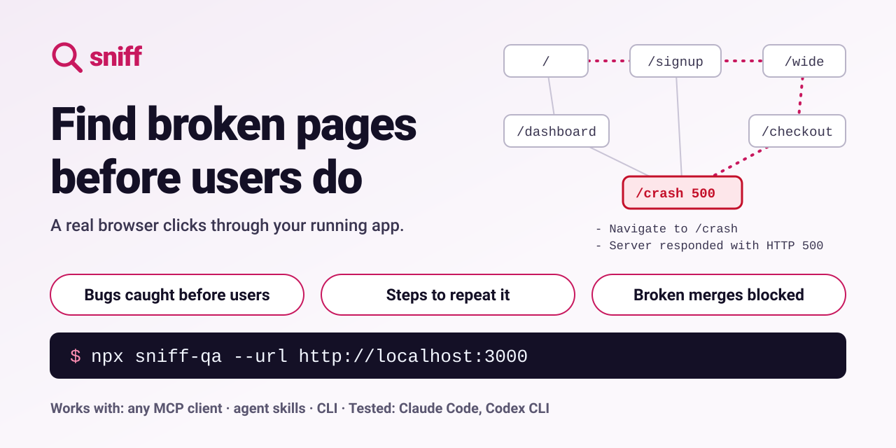
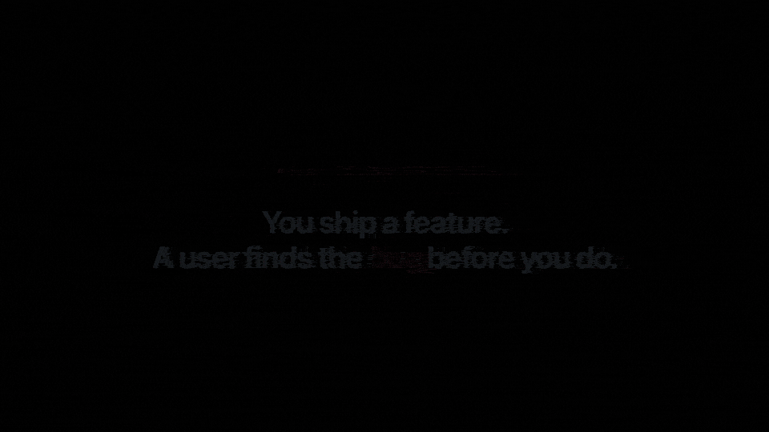

<picture>
  <source media="(prefers-color-scheme: dark)" srcset="https://raw.githubusercontent.com/Aboudjem/sniff/main/.github/assets/hero-dark.svg">
  <source media="(prefers-color-scheme: light)" srcset="https://raw.githubusercontent.com/Aboudjem/sniff/main/.github/assets/hero-light.svg">
  
</picture>

<p align="center">
  <a href="https://www.npmjs.com/package/sniff-qa"></a>
  <a href="https://github.com/Aboudjem/sniff/actions/workflows/ci.yml"></a>
  <a href="LICENSE"></a>
</p>

<p align="center"><b>English</b> · <a href="READMEs/zh-CN.md">简体中文</a> · <a href="READMEs/ja.md">日本語</a> · <a href="READMEs/es.md">Español</a> · <a href="READMEs/fr.md">Français</a></p>

<p align="center"><b>Catch broken pages in your web app before users do.</b></p>

sniff opens your running app in a real browser and clicks like a user.

| Bugs caught before users | Steps to repeat it | Broken merges blocked |
|:--|:--|:--|
| Found 21 of 21 planted bugs, 0 false findings: `npm run build && npm run proof`. | Each page bug comes with its route, the steps to repeat it, and a fix. | `--fail-on` exits 1 on critical or high bugs, so CI stops the merge. |

**Works with:** any MCP client, any agent that reads skills, or the command line alone.
MCP is how an agent calls a tool. Tested: Claude Code, Codex CLI. The walk uses a browser, not a model.

```bash
npx sniff-qa --url http://localhost:3000
```

## What you get

A real report from this repo's test app with planted bugs (2026-11-17, sniff 0.9.3):

```text
  VERDICT  FAIL: 26 findings (1 critical, 13 high, 11 medium, 1 low), 1 low-confidence finding hidden
  Walked 12 pages, checked 13 links, in 55.2s. --all shows the hidden one.

  Fix these first:
    1. Page returns HTTP 500 on /crash  [critical]
    2. Page returns HTTP 404 on /dead  [high]
    3. Page returns HTTP 404 on /missing  [high]

  Every finding, with the steps that reproduce it:

  CRITICAL (1)
    • [confirmed] Page returns HTTP 500
      /crash  (route/broken-page)
        - Navigate to /crash
        - Server responded with HTTP 500
      fix: The route throws server-side. Check the server logs/handler for this path and return a valid page or a proper error page.
      shot: sniff-reports/crawl/_crash-desktop.png
```

Use a dev or staging app: a walk clicks buttons and submits real forms.

<p align="center"><a href="#what-you-get">What you get</a> · <a href="#install">Install</a> · <a href="#how-it-works">How it works</a> · <a href="#works-with">Works with</a> · <a href="#proof">Proof</a> · <a href="#faq">FAQ</a> · <a href="#limits">Limits</a></p>

## Install

You changed one form. Now a page you never opened shows a server error (HTTP 500).
sniff finds it for you, with the steps to repeat it and a fix. Most findings also have a screenshot.
It needs no API key and no account.

The first walk downloads about 440 MB once. On a Mac it uses about 730 MB of disk.
Details and the command to measure it are below.

Node.js 22 or newer. Pick one path.

**Command line, no editor.** Start your app, then walk it from a second terminal:

```bash
npx sniff-qa --url http://localhost:3000
```

The npm package is `sniff-qa`. Do not run `npx sniff`: that is an unrelated package.

**Claude Code plugin**, through the [10x marketplace](https://github.com/Aboudjem/10x):

```bash
claude plugin marketplace add Aboudjem/10x
claude plugin install sniff@10x
```

**Skills for any agent**, through the Vercel skills CLI:

```bash
npx skills add Aboudjem/sniff
```

**MCP server**, for any MCP client:

```bash
claude mcp add sniff-qa -- npx -y sniff-qa --mcp
```

The first walk downloads two things once: the browser engine (Playwright, axe-core and
Lighthouse) and Chromium, the browser itself. To do it ahead of time, run:

```bash
npx sniff-qa install
```

It ends with the time it took. On a Mac with empty caches it printed 43 s (2026-11-17, sniff 0.9.3).
It downloaded about 440 MB. It left 193 MB of engine and 530 MB of Chromium on disk.
Sizes vary by platform. To re-measure on macOS:

```bash
du -sm ~/.cache/sniff-qa/engine/* ~/Library/Caches/ms-playwright
```

`npx sniff-qa doctor` checks Node, the browser and your dev server.

The MCP server starts before those downloads. With an empty npm cache, `npx -y sniff-qa@0.9.1 --mcp`
answered its first request in 3.1 to 4.9 s (5 runs, 2026-11-17). Version 0.9.0 took 37 to 93 s,
past Claude Code's 30 s connect limit. To re-measure, in a clone of this repo:

```bash
npm run cold-start -- 0.9.1 5
```

A walk prints progress lines, then the report. You can take the result four ways:

| Output          | Flag        | Use it for                                  |
| :-------------- | :---------- | :------------------------------------------ |
| Terminal report | (default)   | Reading the result now                      |
| HTML page       | `--report`  | Sharing: one file with everything inside    |
| JSON            | `--json`    | Scripts and other tools                     |
| Exit code       | `--fail-on` | Failing CI on real bugs                     |

| Exit code | Meaning                                                                         |
| :-------- | :------------------------------------------------------------------------------ |
| `0`       | No finding reached the `--fail-on` severities (default: critical and high)      |
| `1`       | A finding reached them, an `assert` limit was passed, or sniff could not run    |

<details>
<summary>Project install and CI</summary>

To block bad merges, use `--fail-on` in CI. Its default is critical and high.
`npm install -D sniff-qa` adds it to a project. `npx sniff-qa ci` writes a GitHub Actions workflow
that caches the browser and saves the report. With no app running, its first run only reads your source.
Turn on its `Start the app` step (remove the `#`) and add `--url` to walk the app.
</details>

## How it works





1. **Find the app.** It uses `--url`, or a dev server on a common port.
2. **Walk it.** Chromium, with no window, follows your links, clicks buttons and fills forms, like a user.
3. **Judge what happened.** Each page is checked for 12 classes of bugs.
4. **Prove it.** A finding needs a route and the steps. It adds a screenshot and the console or network lines when it has them.
5. **Report.** Verdict first, then the fix-first list, then the detail.

The 12 classes:

<picture>
  <source media="(prefers-color-scheme: dark)" srcset="https://raw.githubusercontent.com/Aboudjem/sniff/main/.github/assets/features-dark.svg">
  <source media="(prefers-color-scheme: light)" srcset="https://raw.githubusercontent.com/Aboudjem/sniff/main/.github/assets/features-light.svg">
  
</picture>

With no app running, `sniff` reads your source instead (`sniff scan`). It flags debug statements,
placeholder text and broken imports, and tells you how to start the real walk.

The MCP server gives your agent these tools:

| Tool             | What it does                                            |
| :--------------- | :------------------------------------------------------ |
| `sniff`          | One entry point: `mode: "walk"`, `"scan"` or `"report"` |
| `sniff_scan`     | Source-only scan, no browser                            |
| `sniff_run`      | Source scan plus browser checks                         |
| `sniff_discover` | Writes test paths from your source and runs them        |
| `sniff_install`  | Downloads the engine and Chromium, with progress        |
| `sniff_report`   | Reads the last saved results                            |

`--caps scan,report` limits the server to `sniff_scan`, `sniff_report` and the main `sniff` tool. Then it uses no browser at all.

## Works with

Each row was tested on 2026-11-17 against the sniff 0.9.0 build.

| Agent          | What ran                                                                         | Tested     |
| :------------- | :------------------------------------------------------------------------------- | :--------- |
| Claude Code    | `claude -p` with sniff as an MCP server called `sniff_scan` and read 2 findings  | 2026-11-17 |
| Codex CLI      | `codex exec` with sniff as an MCP server called `sniff_scan` and read 2 findings | 2026-11-17 |
| Gemini CLI     | `gemini extensions validate .` accepted `gemini-extension.json`                  | 2026-11-17 |
| Any MCP client | `node sniff-tests/mcp-smoke.mjs` listed 6 tools and a walk returned 20 findings  | 2026-11-17 |
| Skills CLI     | `npx skills@1.9.0 add Aboudjem/sniff` installed the 3 skills into a temp folder  | 2026-11-17 |

Documented, not tested today: Cursor, VS Code with Copilot, Windsurf, OpenCode and Zed.
Their snippets are in [docs/editors.md](docs/editors.md).

## Proof

These commands re-print the numbers on this page. The first prints the score on the test app.

```bash
npm run build && npm run proof
```

It starts the planted-bug test app, walks it, and scores the report. Output on 2026-11-17:

```text
  Recall:    21/21  (100%)
  Findings:  27 deduped (27 raw)
  Matched:   27   Candidate FP: 0   Precision proxy: 100%
  Hard FP on clean page (/clean): 0
```

The sample above shows 26 findings and says 1 low-confidence finding is hidden. The proof run uses `--all`, so it counts all 27.

The test app holds 21 bugs added on purpose (planted bugs) across all 12 classes. It also has one clean page with no bug.
The scorer is [sniff-tests/score-fixture.mjs](sniff-tests/score-fixture.mjs).
The bugs are listed in [sniff-tests/planted-bugs/MANIFEST.json](sniff-tests/planted-bugs/MANIFEST.json).

To get the same report as the sample, start the test app. Then run sniff in a second terminal:

```bash
node sniff-tests/planted-bugs/server.mjs 4517
npx sniff-qa --url http://localhost:4517
```
```bash
npm test
```

Prints `Test Files  54 passed (54)` and `Tests  603 passed (603)` on 2026-11-17.
The suite includes a gate on the test app. It fails the build if sniff finds fewer than 85% of the planted bugs.
It also fails if sniff reports anything on the clean page.

```bash
node sniff-tests/mcp-smoke.mjs
```

Prints the 6 MCP tools and the 20 findings quoted in the table above.

## FAQ

**Do I need an API key or an account?**
No. The walk and the source scan run on your machine. Nothing is sent anywhere unless you set up the optional AI exploration yourself.

**Will a walk change data in my app?**
It can. A walk clicks buttons and submits real forms, so point it at a dev or staging app.

**Why did it exit 1 when nothing crashed?**
Exit 1 means it found bugs at a failing severity, so CI fails the build. Pass `--fail-on none` to always exit 0.

**Will it edit my code?**
No. Walking and scanning never touch your source. Only `sniff fix` edits files, and only when you run it.

**Can it walk a logged-in app?**
Yes. Pass `--storage-state auth.json`. Cookie and token values from that file are hidden in the written reports.

More answers are in [docs/faq.md](docs/faq.md).

## Limits

- It needs a running app for the walk. Without one you only get the source scan.
- The first walk needs internet to download the engine and Chromium once: about 440 MB, then about 730 MB on disk on a Mac.
- Until then, MCP browser tools answer `needsSetup` and the agent calls `sniff_install` first.
- Dead-link checking follows external links, so a walk requests the third-party URLs your pages link to.
- Hiding secrets covers report text, not screenshots. A screenshot of a logged-in page can show private data.
- It finds what a user would see. It does not read your server logs or measure load.

## Learn more

- [docs/editors.md](docs/editors.md): install and MCP snippets for every agent
- [docs/authenticated-walks.md](docs/authenticated-walks.md): walking a logged-in app
- [docs/assert-budgets.md](docs/assert-budgets.md): limits on findings by severity in `sniff.config`
- [docs/comparison.md](docs/comparison.md): how sniff differs from linters and end-to-end test tools
- [CHANGELOG.md](CHANGELOG.md) · [CONTRIBUTING.md](CONTRIBUTING.md) · [LICENSE](LICENSE)

---

<p align="center"><sub>Built by <a href="https://github.com/Aboudjem">Adam Boudjemaa</a> · <a href="LICENSE">Apache 2.0</a> · built on <a href="https://playwright.dev">Playwright</a> and <a href="https://github.com/dequelabs/axe-core">axe-core</a></sub></p>
