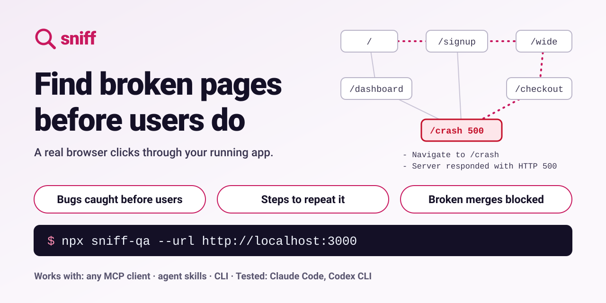
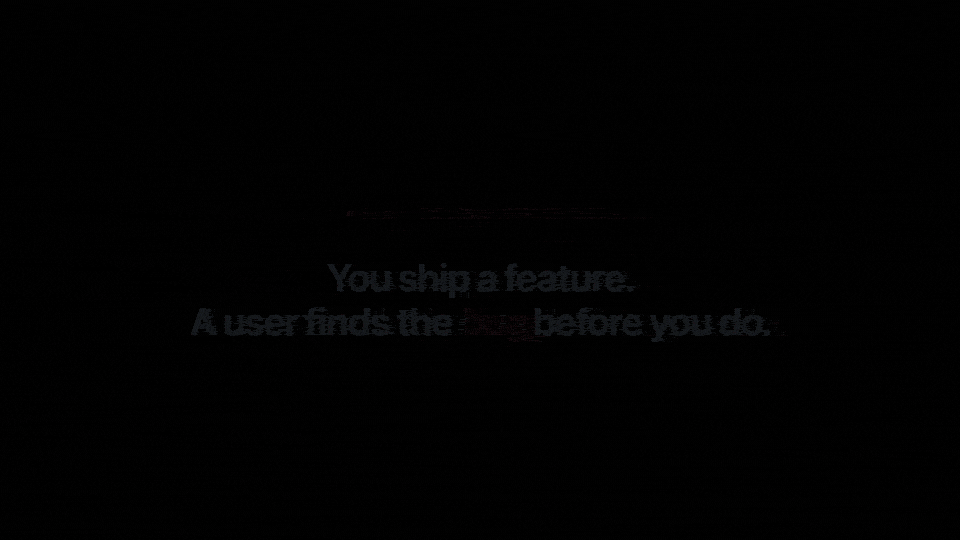

<picture>
  <source media="(prefers-color-scheme: dark)" srcset="https://raw.githubusercontent.com/Aboudjem/sniff/main/.github/assets/hero-dark.svg">
  <source media="(prefers-color-scheme: light)" srcset="https://raw.githubusercontent.com/Aboudjem/sniff/main/.github/assets/hero-light.svg">
  
</picture>

<p align="center">
  <a href="https://www.npmjs.com/package/sniff-qa"></a>
  <a href="https://github.com/Aboudjem/sniff/actions/workflows/ci.yml"></a>
  <a href="../LICENSE"></a>
</p>

<p align="center"><a href="../README.md">English</a> · <a href="zh-CN.md">简体中文</a> · <a href="ja.md">日本語</a> · <b>Español</b> · <a href="fr.md">Français</a></p>

<p align="center"><b>Encuentra las páginas rotas de tu aplicación web antes que tus usuarios.</b></p>

sniff abre tu aplicación en marcha en un navegador real y hace clic como un usuario.

| Bugs encontrados antes que los usuarios | Pasos para repetirlo | Merges rotos bloqueados |
|:--|:--|:--|
| Encontró 21 de 21 bugs plantados, 0 hallazgos falsos: `npm run build && npm run proof`. | Cada bug de página trae su ruta, los pasos para repetirlo y una solución. | `--fail-on` sale con 1 ante bugs críticos o altos, así la CI detiene el merge. |

**Funciona con:** cualquier cliente MCP, cualquier agente que lea skills, o solo la línea de comandos. MCP es la forma en que un agente llama a una herramienta.

Probado: Claude Code, Codex CLI. El recorrido usa un navegador, no un modelo.

- **Qué es:** un buscador de bugs para tu aplicación web en marcha. No escribes ninguna prueba.
- **Cuándo usarlo:** después de cambiar código, antes de hacer merge o publicar.
- **Qué obtienes:** primero un veredicto, luego cada bug con su ruta, sus pasos y una solución.

```bash
npx sniff-qa --url http://localhost:3000
```

## Qué obtienes

Un informe real de la aplicación de prueba con bugs plantados de este repositorio (2026-11-17, sniff 0.9.3):

```text
  VERDICT  FAIL: 26 findings (1 critical, 13 high, 11 medium, 1 low), 1 low-confidence finding hidden
  Walked 12 pages, checked 13 links, in 55.2s. --all shows the hidden one.

  Fix these first:
    1. Page returns HTTP 500 on /crash  [critical]
    2. Page returns HTTP 404 on /dead  [high]
    3. Page returns HTTP 404 on /missing  [high]

  Every finding, with the steps that reproduce it:

  CRITICAL (1)
    • [confirmed] Page returns HTTP 500
      /crash  (route/broken-page)
        - Navigate to /crash
        - Server responded with HTTP 500
      fix: The route throws server-side. Check the server logs/handler for this path and return a valid page or a proper error page.
      shot: sniff-reports/crawl/_crash-desktop.png
```

Usa una aplicación de desarrollo o de staging: un recorrido pulsa botones y envía formularios reales.

<p align="center"><a href="#qué-obtienes">Qué obtienes</a> · <a href="#instalación">Instalación</a> · <a href="#cómo-funciona">Cómo funciona</a> · <a href="#compatibilidad">Compatibilidad</a> · <a href="#pruebas">Pruebas</a> · <a href="#preguntas-frecuentes">Preguntas frecuentes</a> · <a href="#límites">Límites</a></p>

## Instalación

**Pruébalo sin instalar nada.** Arranca tu aplicación y recórrela desde una segunda terminal:

```bash
npx sniff-qa --url http://localhost:3000
```

El paquete de npm es `sniff-qa`. No ejecutes `npx sniff`: es otro paquete sin relación.

**Recomendado: la CLI de skills de Vercel.** `npx skills` es el instalador abierto de Vercel para skills de agentes.

```bash
npx skills add Aboudjem/sniff -g
```

Funciona en más de 70 agentes: elige el tuyo en el menú ([agentes compatibles](https://github.com/vercel-labs/skills#supported-agents)).
En una terminal muestra el menú de agentes. En un script instala en todas las carpetas de agentes, así que añade `-a <agent>`.
`-g` instala para todos tus proyectos. Solo este proyecto: quita `-g`.
Solo instala las 3 skills. El servidor MCP es un paso aparte de una línea, más abajo.

<p><a href="https://skills.sh/aboudjem/sniff"></a> <a href="https://skills.sh/aboudjem/sniff">skills.sh/aboudjem/sniff</a></p>

**O instala directamente en un agente.** Node.js 22 o más reciente.

<p><a href="#claude-code"></a> <a href="#codex"></a> <a href="#cursor"></a> <a href="#gemini-cli"></a> <a href="#github-copilot"></a> <a href="#opencode"></a></p>

#### Claude Code

Instalación probada.

```bash
npx skills add Aboudjem/sniff -g -a claude-code
```

Servidor MCP, probado, para todos tus proyectos:

```bash
claude mcp add -s user sniff-qa -- npx -y sniff-qa --mcp
```

Solo este proyecto: quita `-s user`.

#### Codex

Instalación probada.

```bash
npx skills add Aboudjem/sniff -g -a codex
```

Servidor MCP, probado, para todos tus proyectos:

```bash
codex mcp add sniff-qa -- npx -y sniff-qa --mcp
```

#### Cursor

Instalación probada.

```bash
npx skills add Aboudjem/sniff -g -a cursor
```

#### Gemini CLI

Instalación probada.

```bash
npx skills add Aboudjem/sniff -g -a gemini-cli
```

O añade la extensión, que también trae el servidor MCP (instalación probada):

```bash
gemini extensions install https://github.com/Aboudjem/sniff
```

#### GitHub Copilot

Instalación probada.

```bash
npx skills add Aboudjem/sniff -g -a github-copilot
```

#### OpenCode

Instalación probada.

```bash
npx skills add Aboudjem/sniff -g -a opencode
```

#### Plugin de Claude Code

Añade las skills y el servidor MCP en un paso, a través del [marketplace 10x](https://github.com/Aboudjem/10x):

```bash
claude plugin marketplace add Aboudjem/10x
claude plugin install sniff@10x
```

Cualquier otro cliente MCP ejecuta `npx -y sniff-qa --mcp`. Los fragmentos para cada editor están en [docs/editors.md](../docs/editors.md).

#### Primera ejecución

El primer recorrido descarga unos 440 MB una sola vez. En un Mac ocupa unos 730 MB de disco.
Descarga el motor de navegación (Playwright, axe-core y Lighthouse) y Chromium, el navegador en sí.
Para hacerlo antes, ejecuta:

```bash
npx sniff-qa install
```

Termina mostrando el tiempo que tardó. En un Mac con cachés vacías mostró 43 s (2026-11-17, sniff 0.9.3).
Dejó 193 MB de motor y 530 MB de Chromium en disco.
Los tamaños varían según la plataforma. Para medirlo de nuevo en macOS:

```bash
du -sm ~/.cache/sniff-qa/engine/* ~/Library/Caches/ms-playwright
```

`npx sniff-qa doctor` revisa Node, el navegador y tu servidor de desarrollo.

El servidor MCP arranca antes de esas descargas. Con la caché de npm vacía, `npx -y sniff-qa@0.9.1 --mcp`
respondió a su primera petición en 3,1 a 4,9 s (5 ejecuciones, 2026-11-17). La versión 0.9.0 tardaba de 37 a 93 s,
más que el límite de conexión de 30 s de Claude Code. Para medirlo de nuevo, en un clon de este repositorio:

```bash
npm run cold-start -- 0.9.1 5
```

Un recorrido muestra líneas de progreso y luego el informe. Puedes obtener el resultado de cuatro formas:

| Salida             | Opción      | Para qué sirve                                |
| :----------------- | :---------- | :-------------------------------------------- |
| Informe en terminal | (por defecto) | Leer el resultado ahora                      |
| Página HTML        | `--report`  | Compartir: un solo archivo con todo dentro    |
| JSON               | `--json`    | Scripts y otras herramientas                  |
| Código de salida   | `--fail-on` | Hacer fallar la CI con bugs reales            |

| Código de salida | Significado                                                                              |
| :--------------- | :--------------------------------------------------------------------------------------- |
| `0`              | Ningún hallazgo alcanzó las severidades de `--fail-on` (por defecto: crítica y alta)      |
| `1`              | Un hallazgo las alcanzó, se superó un límite de `assert`, o sniff no pudo ejecutarse     |

<details>
<summary>Instalación en un proyecto y CI</summary>

Para bloquear merges malos, usa `--fail-on` en la CI. Por defecto actúa con crítica y alta.
`npm install -D sniff-qa` lo añade a un proyecto. `npx sniff-qa ci` escribe un workflow de GitHub Actions
que guarda el navegador en caché y conserva el informe. Sin aplicación en marcha, su primera ejecución solo lee tu código fuente.
Activa su paso `Start the app` (quita el `#`) y añade `--url` para recorrer la aplicación.
</details>

## Cómo funciona

Ejemplo: cambias un formulario, y una página que nunca abriste ahora muestra un error del servidor (HTTP 500).
sniff recorre las páginas a las que llegan tus enlaces, así que puede encontrar ese error antes que tus usuarios.





1. **Encontrar la aplicación.** Usa `--url`, o un servidor de desarrollo en un puerto habitual.
2. **Recorrerla.** Chromium, sin ventana, sigue tus enlaces, pulsa botones y rellena formularios, como un usuario.
3. **Juzgar lo que pasó.** Cada página se revisa para 12 clases de bugs.
4. **Probarlo.** Un hallazgo necesita una ruta y los pasos. Añade una captura y las líneas de consola o de red cuando las tiene.
5. **Informar.** Primero el veredicto, luego la lista de lo que hay que arreglar primero, luego el detalle.

Las 12 clases:

<picture>
  <source media="(prefers-color-scheme: dark)" srcset="https://raw.githubusercontent.com/Aboudjem/sniff/main/.github/assets/features-dark.svg">
  <source media="(prefers-color-scheme: light)" srcset="https://raw.githubusercontent.com/Aboudjem/sniff/main/.github/assets/features-light.svg">
  
</picture>

Sin aplicación en marcha, `sniff` lee tu código fuente (`sniff scan`). Señala sentencias de depuración,
texto provisional e imports rotos, y te dice cómo lanzar el recorrido real.

El servidor MCP da a tu agente estas herramientas:

| Herramienta      | Qué hace                                                        |
| :--------------- | :-------------------------------------------------------------- |
| `sniff`          | Un solo punto de entrada: `mode: "walk"`, `"scan"` o `"report"` |
| `sniff_scan`     | Análisis solo del código fuente, sin navegador                  |
| `sniff_run`      | Análisis del código más comprobaciones en el navegador          |
| `sniff_discover` | Escribe recorridos de prueba desde tu código y los ejecuta      |
| `sniff_install`  | Descarga el motor y Chromium, con progreso                      |
| `sniff_report`   | Lee los últimos resultados guardados                            |

`--caps scan,report` limita el servidor a `sniff_scan`, `sniff_report` y la herramienta principal `sniff`. Entonces no usa ningún navegador.

## Compatibilidad

Cada fila se probó el 2026-11-17. Las cinco primeras con la versión 0.9.0 de sniff, las filas de instalación con la 0.9.4.

| Agente         | Qué se ejecutó                                                                            | Probado    |
| :------------- | :---------------------------------------------------------------------------------------- | :--------- |
| Claude Code    | `claude -p` con sniff como servidor MCP llamó a `sniff_scan` y leyó 2 hallazgos          | 2026-11-17 |
| Codex CLI      | `codex exec` con sniff como servidor MCP llamó a `sniff_scan` y leyó 2 hallazgos         | 2026-11-17 |
| Gemini CLI     | `gemini extensions validate .` aceptó `gemini-extension.json`                             | 2026-11-17 |
| Cualquier cliente MCP | `node sniff-tests/mcp-smoke.mjs` listó 6 herramientas y un recorrido dio 20 hallazgos | 2026-11-17 |
| CLI de skills  | `npx skills@1.9.0 add Aboudjem/sniff` instaló las 3 skills en una carpeta temporal       | 2026-11-17 |
| Claude Code    | `claude mcp add -s user` escribió sniff-qa en el `.claude.json` de una carpeta personal desechable | 2026-11-17 |
| Codex CLI      | `codex mcp add` escribió sniff-qa en el `config.toml` de una carpeta personal desechable | 2026-11-17 |
| Gemini CLI     | `gemini extensions install` instaló y activó sniff en una carpeta personal desechable | 2026-11-17 |
| Cursor         | `skills add -g -a cursor` puso las 3 skills en un `~/.agents/skills` desechable | 2026-11-17 |
| GitHub Copilot | `skills add -g -a github-copilot` puso las 3 skills en `~/.agents/skills` | 2026-11-17 |
| OpenCode       | `skills add -g -a opencode` puso las 3 skills en `~/.agents/skills` | 2026-11-17 |
| Claude Code    | `skills add -g -a claude-code` puso las 3 skills en `~/.claude/skills` | 2026-11-17 |
| Codex CLI      | `skills add -g -a codex` puso las 3 skills en `~/.agents/skills` | 2026-11-17 |
| Gemini CLI     | `skills add -g -a gemini-cli` puso las 3 skills en `~/.agents/skills` | 2026-11-17 |
| CLI de skills  | `skills add -g` sin terminal instaló en todas las carpetas de agentes | 2026-11-17 |

Documentados, no probados hoy: Windsurf y Zed. En Cursor, Copilot y OpenCode solo se probó la instalación.
Sus fragmentos están en [docs/editors.md](../docs/editors.md).

## Pruebas

Estos comandos vuelven a imprimir las cifras de esta página. El primero imprime la puntuación en la aplicación de prueba.

```bash
npm run build && npm run proof
```

Arranca la aplicación de prueba con bugs plantados, la recorre y puntúa el informe. Salida del 2026-11-17:

```text
  Recall:    21/21  (100%)
  Findings:  27 deduped (27 raw)
  Matched:   27   Candidate FP: 0   Precision proxy: 100%
  Hard FP on clean page (/clean): 0
```

El ejemplo de arriba muestra 26 hallazgos y dice que 1 hallazgo de baja confianza está oculto. La prueba usa `--all`, así que cuenta los 27.

La aplicación de prueba tiene 21 bugs añadidos a propósito (bugs plantados) en las 12 clases. También tiene una página limpia, sin bugs.
El evaluador es [sniff-tests/score-fixture.mjs](../sniff-tests/score-fixture.mjs).
Los bugs están listados en [sniff-tests/planted-bugs/MANIFEST.json](../sniff-tests/planted-bugs/MANIFEST.json).

Para obtener el mismo informe que el ejemplo, arranca la aplicación de prueba. Luego ejecuta sniff en una segunda terminal:

```bash
node sniff-tests/planted-bugs/server.mjs 4517
npx sniff-qa --url http://localhost:4517
```
```bash
npm test
```

Imprime `Test Files  54 passed (54)` y `Tests  603 passed (603)` el 2026-11-17.
La suite incluye un control sobre la aplicación de prueba. Hace fallar el build si sniff encuentra menos del 85 % de los bugs plantados.
También falla si sniff informa algo en la página limpia.

```bash
node sniff-tests/mcp-smoke.mjs
```

Imprime las 6 herramientas MCP y los 20 hallazgos citados en la tabla de arriba.

## Preguntas frecuentes

**¿Necesito una clave de API o una cuenta?**
No. El recorrido y el análisis del código se ejecutan en tu máquina. No se envía nada, salvo que tú mismo configures la exploración con IA opcional.

**¿Puede un recorrido cambiar datos de mi aplicación?**
Sí. Un recorrido pulsa botones y envía formularios reales, así que apúntalo a una aplicación de desarrollo o de staging.

**¿Por qué salió con 1 si nada se rompió?**
Salir con 1 significa que encontró bugs de una severidad que hace fallar, así que la CI falla el build. Pasa `--fail-on none` para salir siempre con 0.

**¿Va a editar mi código?**
No. Recorrer y analizar nunca tocan tu código. Solo `sniff fix` edita archivos, y solo cuando tú lo ejecutas.

**¿Puede recorrer una aplicación con inicio de sesión?**
Sí. Pasa `--storage-state auth.json`. Los valores de cookies y tokens de ese archivo se ocultan en los informes escritos.

Hay más respuestas en [docs/faq.md](../docs/faq.md).

## Límites

- Necesita una aplicación en marcha para el recorrido. Sin ella solo obtienes el análisis del código fuente.
- El primer recorrido necesita internet para descargar el motor y Chromium una vez: unos 440 MB, luego unos 730 MB en disco en un Mac.
- Hasta entonces, las herramientas MCP de navegador responden `needsSetup` y el agente llama primero a `sniff_install`.
- La revisión de enlaces muertos sigue los enlaces externos, así que un recorrido pide las URL de terceros a las que enlazan tus páginas.
- Ocultar secretos cubre el texto de los informes, no las capturas. Una captura de una página con sesión iniciada puede mostrar datos privados.
- Encuentra lo que vería un usuario. No lee los registros de tu servidor ni mide la carga.

## Más información

- [docs/editors.md](../docs/editors.md): instalación y fragmentos MCP para cada agente
- [docs/authenticated-walks.md](../docs/authenticated-walks.md): recorrer una aplicación con inicio de sesión
- [docs/assert-budgets.md](../docs/assert-budgets.md): límites de hallazgos por severidad en `sniff.config`
- [docs/comparison.md](../docs/comparison.md): en qué se diferencia sniff de los linters y de las herramientas de pruebas de extremo a extremo
- [CHANGELOG.md](../CHANGELOG.md) · [CONTRIBUTING.md](../CONTRIBUTING.md) · [LICENSE](../LICENSE)

---

<p align="center"><sub>Built by <a href="https://github.com/Aboudjem">Adam Boudjemaa</a> · <a href="../LICENSE">Apache 2.0</a> · built on <a href="https://playwright.dev">Playwright</a> and <a href="https://github.com/dequelabs/axe-core">axe-core</a></sub></p>

<p align="center"><sub>Esta traducción se hizo con ayuda automática. La versión de referencia es el <a href="../README.md">README.md</a> en inglés.</sub></p>
