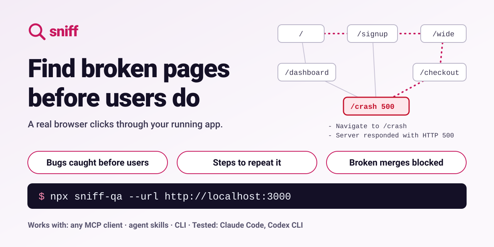
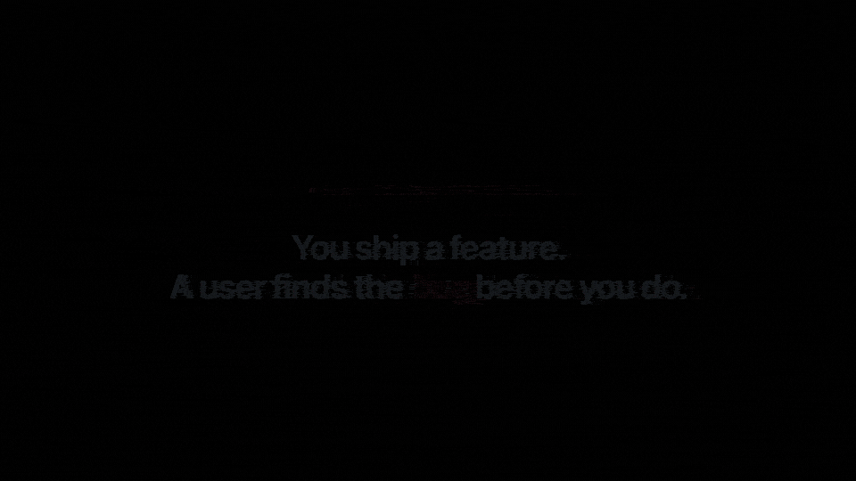

<picture>
  <source media="(prefers-color-scheme: dark)" srcset="https://raw.githubusercontent.com/Aboudjem/sniff/main/.github/assets/hero-dark.svg">
  <source media="(prefers-color-scheme: light)" srcset="https://raw.githubusercontent.com/Aboudjem/sniff/main/.github/assets/hero-light.svg">
  
</picture>

<p align="center">
  <a href="https://www.npmjs.com/package/sniff-qa"></a>
  <a href="https://github.com/Aboudjem/sniff/actions/workflows/ci.yml"></a>
  <a href="../LICENSE"></a>
</p>

<p align="center"><a href="../README.md">English</a> · <a href="zh-CN.md">简体中文</a> · <a href="ja.md">日本語</a> · <a href="es.md">Español</a> · <b>Français</b></p>

<p align="center"><b>Trouvez les pages cassées de votre application web avant vos utilisateurs.</b></p>

sniff ouvre votre application lancée dans un vrai navigateur et clique comme un utilisateur.

| Bugs trouvés avant les utilisateurs | Étapes pour le reproduire | Merges cassés bloqués |
|:--|:--|:--|
| 21 bugs plantés sur 21 trouvés, 0 faux constat : `npm run build && npm run proof`. | Chaque bug de page vient avec sa route, les étapes pour le reproduire et une correction. | `--fail-on` sort en 1 sur un bug critique ou élevé, donc la CI bloque le merge. |

**Compatible avec :** tout client MCP, tout agent qui lit des skills, ou la ligne de commande seule.
MCP permet à un agent d'appeler un outil. Testé : Claude Code, Codex CLI. Le parcours utilise un navigateur, pas un modèle.

```bash
npx sniff-qa --url http://localhost:3000
```

## Ce que vous obtenez

Un vrai rapport sur l'application de test à bugs plantés de ce dépôt (2026-11-17, sniff 0.9.3) :

```text
  VERDICT  FAIL: 26 findings (1 critical, 13 high, 11 medium, 1 low), 1 low-confidence finding hidden
  Walked 12 pages, checked 13 links, in 55.2s. --all shows the hidden one.

  Fix these first:
    1. Page returns HTTP 500 on /crash  [critical]
    2. Page returns HTTP 404 on /dead  [high]
    3. Page returns HTTP 404 on /missing  [high]

  Every finding, with the steps that reproduce it:

  CRITICAL (1)
    • [confirmed] Page returns HTTP 500
      /crash  (route/broken-page)
        - Navigate to /crash
        - Server responded with HTTP 500
      fix: The route throws server-side. Check the server logs/handler for this path and return a valid page or a proper error page.
      shot: sniff-reports/crawl/_crash-desktop.png
```

Utilisez une application de développement ou de préproduction : un parcours clique sur des boutons et envoie de vrais formulaires.

<p align="center"><a href="#ce-que-vous-obtenez">Ce que vous obtenez</a> · <a href="#installation">Installation</a> · <a href="#comment-ça-marche">Comment ça marche</a> · <a href="#compatibilité">Compatibilité</a> · <a href="#preuve">Preuve</a> · <a href="#faq">FAQ</a> · <a href="#limites">Limites</a></p>

## Installation

Vous avez changé un formulaire. Une page que vous n'avez jamais ouverte affiche maintenant une erreur serveur (HTTP 500).
sniff la trouve pour vous, avec les étapes pour la reproduire et une correction. La plupart des constats ont aussi une capture d'écran.
Il ne demande ni clé d'API ni compte.

Le premier parcours télécharge environ 440 Mo une seule fois. Sur un Mac, il occupe environ 730 Mo de disque.
Les détails et la commande pour le mesurer sont plus bas.

Node.js 22 ou plus récent. Choisissez une voie.

**En ligne de commande, sans éditeur.** Démarrez votre application, puis parcourez-la depuis un second terminal :

```bash
npx sniff-qa --url http://localhost:3000
```

Le paquet npm s'appelle `sniff-qa`. N'exécutez pas `npx sniff` : c'est un autre paquet, sans lien.

**Plugin Claude Code**, via la [marketplace 10x](https://github.com/Aboudjem/10x) :

```bash
claude plugin marketplace add Aboudjem/10x
claude plugin install sniff@10x
```

**Skills pour tout agent**, via la CLI skills de Vercel :

```bash
npx skills add Aboudjem/sniff
```

**Serveur MCP**, pour tout client MCP :

```bash
claude mcp add sniff-qa -- npx -y sniff-qa --mcp
```

Le premier parcours télécharge deux choses, une seule fois : le moteur de navigation (Playwright, axe-core et
Lighthouse) et Chromium, le navigateur lui-même. Pour le faire à l'avance, lancez :

```bash
npx sniff-qa install
```

Il termine en affichant le temps pris. Sur un Mac aux caches vides, il a affiché 43 s (2026-11-17, sniff 0.9.3).
Il a téléchargé environ 440 Mo. Il a laissé 193 Mo de moteur et 530 Mo de Chromium sur le disque.
Les tailles varient selon la plateforme. Pour mesurer à nouveau sur macOS :

```bash
du -sm ~/.cache/sniff-qa/engine/* ~/Library/Caches/ms-playwright
```

`npx sniff-qa doctor` vérifie Node, le navigateur et votre serveur de développement.

Le serveur MCP démarre avant ces téléchargements. Avec un cache npm vide, `npx -y sniff-qa@0.9.1 --mcp`
a répondu à sa première requête en 3,1 à 4,9 s (5 essais, 2026-11-17). La version 0.9.0 prenait 37 à 93 s,
au-delà de la limite de connexion de 30 s de Claude Code. Pour mesurer à nouveau, dans un clone de ce dépôt :

```bash
npm run cold-start -- 0.9.1 5
```

Un parcours affiche des lignes de progression, puis le rapport. Vous pouvez obtenir le résultat de quatre façons :

| Sortie            | Option      | À utiliser pour                              |
| :---------------- | :---------- | :------------------------------------------- |
| Rapport terminal  | (défaut)    | Lire le résultat tout de suite               |
| Page HTML         | `--report`  | Partager : un seul fichier qui contient tout |
| JSON              | `--json`    | Scripts et autres outils                     |
| Code de sortie    | `--fail-on` | Faire échouer la CI sur de vrais bugs        |

| Code de sortie | Sens                                                                                     |
| :------------- | :--------------------------------------------------------------------------------------- |
| `0`            | Aucun constat n'a atteint les sévérités de `--fail-on` (défaut : critique et élevée)     |
| `1`            | Un constat les a atteintes, une limite `assert` a été dépassée, ou sniff n'a pas pu tourner |

<details>
<summary>Installation dans un projet et CI</summary>

Pour bloquer les mauvais merges, utilisez `--fail-on` en CI. Par défaut, il vise critique et élevée.
`npm install -D sniff-qa` l'ajoute à un projet. `npx sniff-qa ci` écrit un workflow GitHub Actions
qui met le navigateur en cache et garde le rapport. Sans application lancée, sa première exécution lit seulement votre code source.
Activez son étape `Start the app` (retirez le `#`) et ajoutez `--url` pour parcourir l'application.
</details>

## Comment ça marche





1. **Trouver l'application.** Il utilise `--url`, ou un serveur de développement sur un port courant.
2. **La parcourir.** Chromium, sans fenêtre, suit vos liens, clique sur les boutons et remplit les formulaires, comme un utilisateur.
3. **Juger ce qui s'est passé.** Chaque page est vérifiée pour 12 classes de bugs.
4. **Le prouver.** Un constat exige une route et les étapes. Il ajoute une capture d'écran et les lignes de console ou de réseau quand il les a.
5. **Rapporter.** Le verdict d'abord, puis la liste à corriger en premier, puis le détail.

Les 12 classes :

<picture>
  <source media="(prefers-color-scheme: dark)" srcset="https://raw.githubusercontent.com/Aboudjem/sniff/main/.github/assets/features-dark.svg">
  <source media="(prefers-color-scheme: light)" srcset="https://raw.githubusercontent.com/Aboudjem/sniff/main/.github/assets/features-light.svg">
  
</picture>

Sans application lancée, `sniff` lit votre code source à la place (`sniff scan`). Il signale les instructions de débogage,
le texte provisoire et les imports cassés, et vous dit comment lancer le vrai parcours.

Le serveur MCP donne ces outils à votre agent :

| Outil            | Ce qu'il fait                                                |
| :--------------- | :----------------------------------------------------------- |
| `sniff`          | Un seul point d'entrée : `mode: "walk"`, `"scan"` ou `"report"` |
| `sniff_scan`     | Analyse du code source seul, sans navigateur                 |
| `sniff_run`      | Analyse du code source plus vérifications dans le navigateur |
| `sniff_discover` | Écrit des parcours de test depuis votre code et les exécute  |
| `sniff_install`  | Télécharge le moteur et Chromium, avec la progression        |
| `sniff_report`   | Lit les derniers résultats enregistrés                       |

`--caps scan,report` limite le serveur à `sniff_scan`, `sniff_report` et à l'outil principal `sniff`. Il n'utilise alors aucun navigateur.

## Compatibilité

Chaque ligne a été testée le 2026-11-17 avec la version 0.9.0 de sniff.

| Agent          | Ce qui a tourné                                                                          | Testé      |
| :------------- | :--------------------------------------------------------------------------------------- | :--------- |
| Claude Code    | `claude -p` avec sniff en serveur MCP a appelé `sniff_scan` et lu 2 constats             | 2026-11-17 |
| Codex CLI      | `codex exec` avec sniff en serveur MCP a appelé `sniff_scan` et lu 2 constats            | 2026-11-17 |
| Gemini CLI     | `gemini extensions validate .` a accepté `gemini-extension.json`                         | 2026-11-17 |
| Tout client MCP | `node sniff-tests/mcp-smoke.mjs` a listé 6 outils et un parcours a rendu 20 constats    | 2026-11-17 |
| CLI skills     | `npx skills@1.9.0 add Aboudjem/sniff` a installé les 3 skills dans un dossier temporaire | 2026-11-17 |

Documentés, non testés aujourd'hui : Cursor, VS Code avec Copilot, Windsurf, OpenCode et Zed.
Leurs extraits sont dans [docs/editors.md](../docs/editors.md).

## Preuve

Ces commandes réaffichent les chiffres de cette page. La première affiche le score sur l'application de test.

```bash
npm run build && npm run proof
```

Elle démarre l'application de test à bugs plantés, la parcourt et note le rapport. Sortie du 2026-11-17 :

```text
  Recall:    21/21  (100%)
  Findings:  27 deduped (27 raw)
  Matched:   27   Candidate FP: 0   Precision proxy: 100%
  Hard FP on clean page (/clean): 0
```

L'exemple plus haut montre 26 constats et indique 1 constat à faible confiance masqué. La preuve utilise `--all`, donc elle les compte tous les 27.

L'application de test contient 21 bugs ajoutés exprès (bugs plantés), dans les 12 classes. Elle a aussi une page propre, sans bug.
Le correcteur est [sniff-tests/score-fixture.mjs](../sniff-tests/score-fixture.mjs).
Les bugs sont listés dans [sniff-tests/planted-bugs/MANIFEST.json](../sniff-tests/planted-bugs/MANIFEST.json).

Pour obtenir le même rapport que l'exemple, démarrez l'application de test. Puis lancez sniff dans un second terminal :

```bash
node sniff-tests/planted-bugs/server.mjs 4517
npx sniff-qa --url http://localhost:4517
```
```bash
npm test
```

Affiche `Test Files  54 passed (54)` et `Tests  603 passed (603)` le 2026-11-17.
La suite contient un contrôle sur l'application de test. Il fait échouer le build si sniff trouve moins de 85 % des bugs plantés.
Il échoue aussi si sniff signale quoi que ce soit sur la page propre.

```bash
node sniff-tests/mcp-smoke.mjs
```

Affiche les 6 outils MCP et les 20 constats cités dans le tableau plus haut.

## FAQ

**Faut-il une clé d'API ou un compte ?**
Non. Le parcours et l'analyse du code tournent sur votre machine. Rien n'est envoyé, sauf si vous configurez vous-même l'exploration IA optionnelle.

**Un parcours peut-il modifier les données de mon application ?**
Oui. Un parcours clique sur des boutons et envoie de vrais formulaires, donc visez une application de développement ou de préproduction.

**Pourquoi est-il sorti en 1 alors que rien n'a planté ?**
Le code 1 veut dire qu'il a trouvé des bugs d'une sévérité bloquante, donc la CI fait échouer le build. Passez `--fail-on none` pour toujours sortir en 0.

**Va-t-il modifier mon code ?**
Non. Le parcours et l'analyse ne touchent jamais votre code. Seul `sniff fix` modifie des fichiers, et seulement quand vous le lancez.

**Peut-il parcourir une application avec connexion ?**
Oui. Passez `--storage-state auth.json`. Les valeurs de cookies et de jetons de ce fichier sont masquées dans les rapports écrits.

D'autres réponses sont dans [docs/faq.md](../docs/faq.md).

## Limites

- Il lui faut une application lancée pour le parcours. Sans elle, vous n'avez que l'analyse du code source.
- Le premier parcours a besoin d'internet pour télécharger le moteur et Chromium une fois : environ 440 Mo, puis environ 730 Mo sur disque sur un Mac.
- D'ici là, les outils MCP de navigateur répondent `needsSetup` et l'agent appelle d'abord `sniff_install`.
- La vérification des liens morts suit les liens externes, donc un parcours appelle les URL tierces vers lesquelles vos pages pointent.
- Le masquage des secrets couvre le texte des rapports, pas les captures d'écran. Une capture d'une page connectée peut montrer des données privées.
- Il trouve ce qu'un utilisateur verrait. Il ne lit pas les journaux de votre serveur et ne mesure pas la charge.

## En savoir plus

- [docs/editors.md](../docs/editors.md) : installation et extraits MCP pour chaque agent
- [docs/authenticated-walks.md](../docs/authenticated-walks.md) : parcourir une application avec connexion
- [docs/assert-budgets.md](../docs/assert-budgets.md) : limites de constats par sévérité dans `sniff.config`
- [docs/comparison.md](../docs/comparison.md) : ce qui distingue sniff des linters et des outils de test de bout en bout
- [CHANGELOG.md](../CHANGELOG.md) · [CONTRIBUTING.md](../CONTRIBUTING.md) · [LICENSE](../LICENSE)

---

<p align="center"><sub>Built by <a href="https://github.com/Aboudjem">Adam Boudjemaa</a> · <a href="../LICENSE">Apache 2.0</a> · built on <a href="https://playwright.dev">Playwright</a> and <a href="https://github.com/dequelabs/axe-core">axe-core</a></sub></p>

<p align="center"><sub>Cette traduction a été réalisée avec l'aide d'un outil automatique. La version de référence est le <a href="../README.md">README.md</a> en anglais.</sub></p>
