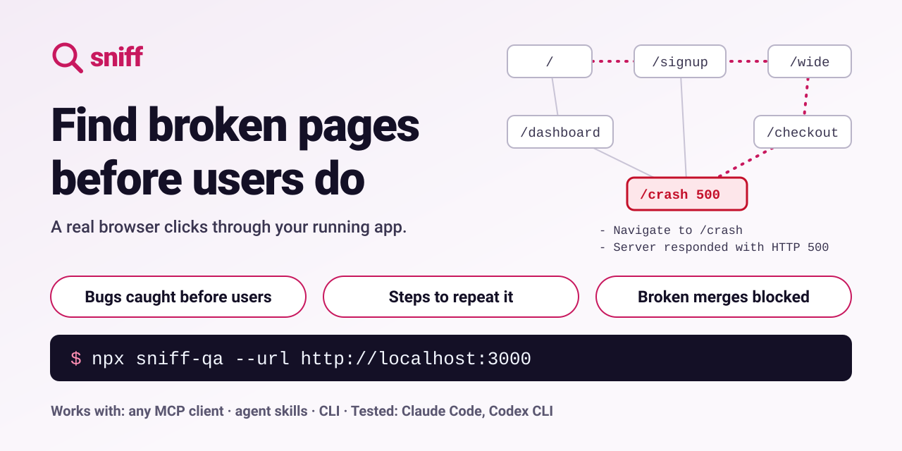
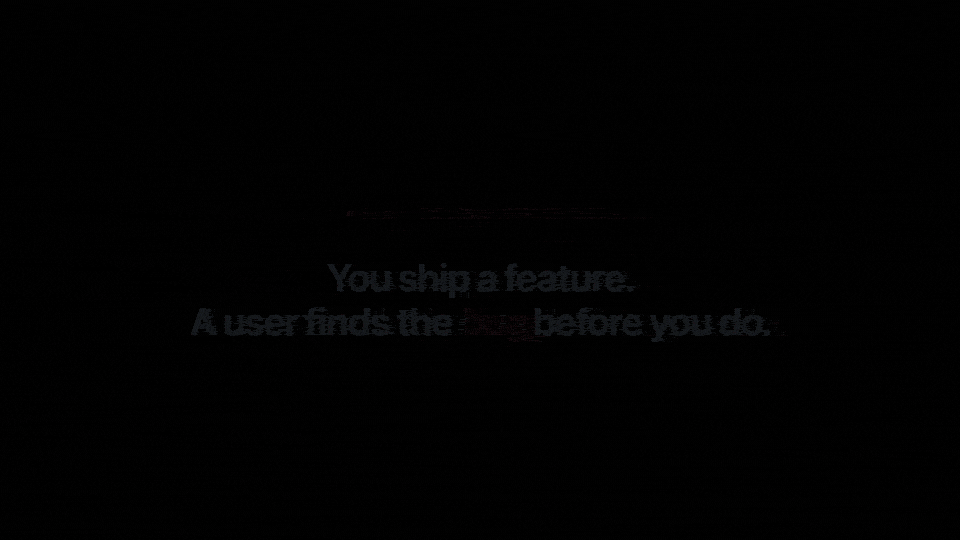

<picture>
  <source media="(prefers-color-scheme: dark)" srcset="https://raw.githubusercontent.com/Aboudjem/sniff/main/.github/assets/hero-dark.svg">
  <source media="(prefers-color-scheme: light)" srcset="https://raw.githubusercontent.com/Aboudjem/sniff/main/.github/assets/hero-light.svg">
  
</picture>

<p align="center">
  <a href="https://www.npmjs.com/package/sniff-qa"></a>
  <a href="https://github.com/Aboudjem/sniff/actions/workflows/ci.yml"></a>
  <a href="../LICENSE"></a>
</p>

<p align="center"><a href="../README.md">English</a> · <a href="zh-CN.md">简体中文</a> · <b>日本語</b> · <a href="es.md">Español</a> · <a href="fr.md">Français</a></p>

<p align="center"><b>Web アプリの壊れたページを、ユーザーより先に見つけます。</b></p>

sniff は動いているアプリを本物のブラウザで開き、ユーザーのようにクリックします。

| ユーザーより先にバグを発見 | 再現手順つき | 壊れたマージを止める |
|:--|:--|:--|
| 仕込んだバグ 21 件中 21 件を発見、誤検出 0 件：`npm run build && npm run proof`。 | ページのバグごとに、ルート、再現手順、修正案がつきます。 | `--fail-on` は critical か high のバグで 1 を返すので、CI がマージを止めます。 |

**対応：** すべての MCP クライアント、skills を読むすべてのエージェント、またはコマンドラインだけ。
MCP はエージェントがツールを呼ぶための仕組みです。テスト済み：Claude Code、Codex CLI。巡回に使うのはブラウザで、モデルではありません。

```bash
npx sniff-qa --url http://localhost:3000
```

## 得られるもの

このリポジトリの、バグを仕込んだテスト用アプリでの実際のレポートです (2026-11-17、sniff 0.9.3)：

```text
  VERDICT  FAIL: 26 findings (1 critical, 13 high, 11 medium, 1 low), 1 low-confidence finding hidden
  Walked 12 pages, checked 13 links, in 55.2s. --all shows the hidden one.

  Fix these first:
    1. Page returns HTTP 500 on /crash  [critical]
    2. Page returns HTTP 404 on /dead  [high]
    3. Page returns HTTP 404 on /missing  [high]

  Every finding, with the steps that reproduce it:

  CRITICAL (1)
    • [confirmed] Page returns HTTP 500
      /crash  (route/broken-page)
        - Navigate to /crash
        - Server responded with HTTP 500
      fix: The route throws server-side. Check the server logs/handler for this path and return a valid page or a proper error page.
      shot: sniff-reports/crawl/_crash-desktop.png
```

開発用かステージング用のアプリを使ってください。巡回はボタンを押し、本物のフォームを送信します。

<p align="center"><a href="#得られるもの">得られるもの</a> · <a href="#インストール">インストール</a> · <a href="#仕組み">仕組み</a> · <a href="#対応エージェント">対応エージェント</a> · <a href="#根拠">根拠</a> · <a href="#faq">FAQ</a> · <a href="#制限">制限</a></p>

## インストール

フォームを 1 つ変えたら、開いたこともないページがサーバーエラー (HTTP 500) を出すようになった。
sniff はそれを見つけ、再現手順と修正案をつけて報告します。ほとんどの指摘にはスクリーンショットもつきます。
API キーもアカウントも不要です。

初回の巡回では約 440 MB を 1 回だけダウンロードします。Mac ではディスクを約 730 MB 使います。
詳細と、それを測るコマンドは下にあります。

Node.js 22 以上が必要です。方法を 1 つ選んでください。

**コマンドライン (エディター不要)。** アプリを起動し、別のターミナルから巡回します：

```bash
npx sniff-qa --url http://localhost:3000
```

npm パッケージ名は `sniff-qa` です。`npx sniff` は実行しないでください。無関係の別パッケージです。

**Claude Code プラグイン**。[10x マーケットプレイス](https://github.com/Aboudjem/10x) から入れます：

```bash
claude plugin marketplace add Aboudjem/10x
claude plugin install sniff@10x
```

**すべてのエージェント向けの skills**。Vercel の skills CLI で入れます：

```bash
npx skills add Aboudjem/sniff
```

**MCP サーバー**。すべての MCP クライアントで使えます：

```bash
claude mcp add sniff-qa -- npx -y sniff-qa --mcp
```

初回の巡回では 2 つのものを 1 回だけダウンロードします。ブラウザエンジン (Playwright、axe-core、
Lighthouse) と、ブラウザ本体の Chromium です。前もって済ませるには次を実行します：

```bash
npx sniff-qa install
```

最後にかかった時間を表示します。キャッシュが空の Mac では 43 秒でした (2026-11-17、sniff 0.9.3)。
ダウンロード量は約 440 MB でした。ディスクにはエンジン 193 MB と Chromium 530 MB が残りました。
サイズはプラットフォームによって変わります。macOS で測り直すには：

```bash
du -sm ~/.cache/sniff-qa/engine/* ~/Library/Caches/ms-playwright
```

`npx sniff-qa doctor` は Node、ブラウザ、開発サーバーを確認します。

MCP サーバーはこれらのダウンロードより前に起動します。npm キャッシュが空の状態で、`npx -y sniff-qa@0.9.1 --mcp`
は最初のリクエストに 3.1〜4.9 秒で応答しました (5 回、2026-11-17)。バージョン 0.9.0 は 37〜93 秒かかり、
Claude Code の 30 秒の接続制限を超えていました。測り直すには、このリポジトリのクローンで：

```bash
npm run cold-start -- 0.9.1 5
```

巡回は進行状況の行を表示し、続いてレポートを出します。結果は 4 つの形で受け取れます：

| 出力               | フラグ      | 用途                                       |
| :----------------- | :---------- | :----------------------------------------- |
| ターミナルのレポート | (既定)      | 結果をすぐ読む                             |
| HTML ページ        | `--report`  | 共有する：すべてが入った 1 つのファイル    |
| JSON               | `--json`    | スクリプトや他のツール                     |
| 終了コード         | `--fail-on` | 本物のバグで CI を失敗させる               |

| 終了コード | 意味                                                                                       |
| :--------- | :----------------------------------------------------------------------------------------- |
| `0`        | `--fail-on` の重大度 (既定：critical と high) に達した指摘はない                          |
| `1`        | 指摘がそれに達した、`assert` の上限を超えた、または sniff を実行できなかった               |

<details>
<summary>プロジェクトへのインストールと CI</summary>

悪いマージを止めるには、CI で `--fail-on` を使います。既定は critical と high です。
`npm install -D sniff-qa` でプロジェクトに追加できます。`npx sniff-qa ci` は GitHub Actions のワークフローを書き出します。
そのワークフローはブラウザをキャッシュし、レポートを保存します。アプリが動いていない場合、最初の実行はソースコードを読むだけです。
`Start the app` のステップを有効にし (`#` を外す)、`--url` を足すとアプリを巡回します。
</details>

## 仕組み





1. **アプリを見つける。** `--url`、またはよく使われるポートの開発サーバーを使います。
2. **巡回する。** ウィンドウのない Chromium がリンクをたどり、ボタンを押し、フォームを埋めます。ユーザーと同じです。
3. **起きたことを判定する。** 各ページを 12 種類のバグについて確認します。
4. **証明する。** 指摘にはルートと手順が必要です。あればスクリーンショットとコンソールやネットワークの行も添えます。
5. **報告する。** 最初に判定、次に先に直すもののリスト、そして詳細です。

12 種類のバグ：

<picture>
  <source media="(prefers-color-scheme: dark)" srcset="https://raw.githubusercontent.com/Aboudjem/sniff/main/.github/assets/features-dark.svg">
  <source media="(prefers-color-scheme: light)" srcset="https://raw.githubusercontent.com/Aboudjem/sniff/main/.github/assets/features-light.svg">
  
</picture>

アプリが動いていなければ、`sniff` は代わりにソースコードを読みます (`sniff scan`)。デバッグ用の文、
仮のテキスト、壊れた import を指摘し、本当の巡回を始める方法を教えます。

MCP サーバーはエージェントに次のツールを渡します：

| ツール           | 内容                                                         |
| :--------------- | :----------------------------------------------------------- |
| `sniff`          | 入口は 1 つ：`mode: "walk"`、`"scan"`、`"report"`            |
| `sniff_scan`     | ソースコードだけを調べる。ブラウザなし                       |
| `sniff_run`      | ソースコードの検査とブラウザでの確認                         |
| `sniff_discover` | ソースからテスト経路を書き、それを実行する                   |
| `sniff_install`  | エンジンと Chromium を進捗つきでダウンロードする             |
| `sniff_report`   | 最後に保存した結果を読む                                     |

`--caps scan,report` はサーバーを `sniff_scan`、`sniff_report`、メインの `sniff` ツールに絞ります。その場合ブラウザは一切使いません。

## 対応エージェント

各行は 2026-11-17 に sniff 0.9.0 のビルドでテストしました。

| エージェント     | 実行した内容                                                                              | テスト日   |
| :--------------- | :---------------------------------------------------------------------------------------- | :--------- |
| Claude Code      | MCP サーバーとして sniff を入れた `claude -p` が `sniff_scan` を呼び、2 件の指摘を読んだ | 2026-11-17 |
| Codex CLI        | MCP サーバーとして sniff を入れた `codex exec` が `sniff_scan` を呼び、2 件の指摘を読んだ | 2026-11-17 |
| Gemini CLI       | `gemini extensions validate .` が `gemini-extension.json` を受け入れた                    | 2026-11-17 |
| すべての MCP クライアント | `node sniff-tests/mcp-smoke.mjs` が 6 つのツールを列挙し、巡回が 20 件の指摘を返した | 2026-11-17 |
| Skills CLI       | `npx skills@1.9.0 add Aboudjem/sniff` が 3 つの skills を一時フォルダーに入れた           | 2026-11-17 |

文書化済みだが今日はテストしていないもの：Cursor、Copilot つきの VS Code、Windsurf、OpenCode、Zed。
設定例は [docs/editors.md](../docs/editors.md) にあります。

## 根拠

次のコマンドで、このページの数字をもう一度表示できます。最初のものはテスト用アプリでのスコアを出します。

```bash
npm run build && npm run proof
```

バグを仕込んだテスト用アプリを起動し、巡回し、レポートを採点します。2026-11-17 の出力：

```text
  Recall:    21/21  (100%)
  Findings:  27 deduped (27 raw)
  Matched:   27   Candidate FP: 0   Precision proxy: 100%
  Hard FP on clean page (/clean): 0
```

上の例は 26 件の指摘を示し、信頼度の低い指摘 1 件を隠したと書いています。根拠の実行は `--all` を使うので、27 件すべてを数えます。

テスト用アプリには、わざと入れたバグ (仕込んだバグ) が 12 種類すべてにわたって 21 件あります。バグのないきれいなページも 1 つあります。
採点スクリプトは [sniff-tests/score-fixture.mjs](../sniff-tests/score-fixture.mjs) です。
バグの一覧は [sniff-tests/planted-bugs/MANIFEST.json](../sniff-tests/planted-bugs/MANIFEST.json) にあります。

例と同じレポートを得るには、テスト用アプリを起動します。そして別のターミナルで sniff を実行します：

```bash
node sniff-tests/planted-bugs/server.mjs 4517
npx sniff-qa --url http://localhost:4517
```
```bash
npm test
```

2026-11-17 に `Test Files  54 passed (54)` と `Tests  603 passed (603)` を表示しました。
テストスイートにはテスト用アプリでのチェックが入っています。仕込んだバグの発見が 85% 未満ならビルドを失敗させます。
きれいなページで sniff が何かを報告した場合も失敗します。

```bash
node sniff-tests/mcp-smoke.mjs
```

6 つの MCP ツールと、上の表にある 20 件の指摘を表示します。

## FAQ

**API キーやアカウントは必要ですか？**
いいえ。巡回とソースの検査はあなたのマシンで動きます。オプションの AI 探索を自分で設定しない限り、何も送信されません。

**巡回でアプリのデータが変わることはありますか？**
あります。巡回はボタンを押し、本物のフォームを送信するので、開発用かステージング用のアプリに向けてください。

**何も落ちていないのに、なぜ 1 で終了したのですか？**
1 での終了は、失敗扱いの重大度のバグを見つけたという意味で、CI はビルドを失敗させます。常に 0 で終了させるには `--fail-on none` を渡します。

**コードを書き換えますか？**
いいえ。巡回と検査はソースに一切触れません。ファイルを編集するのは `sniff fix` だけで、あなたが実行したときだけです。

**ログインが必要なアプリも巡回できますか？**
はい。`--storage-state auth.json` を渡します。そのファイルの Cookie とトークンの値は、書き出したレポートでは隠されます。

ほかの回答は [docs/faq.md](../docs/faq.md) にあります。

## 制限

- 巡回には動いているアプリが必要です。アプリがなければソースの検査だけになります。
- 初回の巡回では、エンジンと Chromium を 1 回ダウンロードするためにインターネットが必要です。約 440 MB で、Mac ではその後ディスクを約 730 MB 使います。
- それまでは、ブラウザを使う MCP ツールは `needsSetup` を返し、エージェントが先に `sniff_install` を呼びます。
- リンク切れの確認は外部リンクもたどるので、巡回はページがリンクする外部の URL にリクエストを送ります。
- 秘密の値を隠す処理はレポートの文字に効き、スクリーンショットには効きません。ログイン後のページのスクリーンショットには個人データが写ることがあります。
- ユーザーに見えるものを見つけます。サーバーのログは読まず、負荷も測りません。

## さらに詳しく

- [docs/editors.md](../docs/editors.md)：各エージェント向けのインストールと MCP の設定例
- [docs/authenticated-walks.md](../docs/authenticated-walks.md)：ログインが必要なアプリの巡回
- [docs/assert-budgets.md](../docs/assert-budgets.md)：`sniff.config` で重大度ごとに指摘数の上限を決める
- [docs/comparison.md](../docs/comparison.md)：sniff とリンターや E2E (エンドツーエンド) テストツールの違い
- [CHANGELOG.md](../CHANGELOG.md) · [CONTRIBUTING.md](../CONTRIBUTING.md) · [LICENSE](../LICENSE)

---

<p align="center"><sub>Built by <a href="https://github.com/Aboudjem">Adam Boudjemaa</a> · <a href="../LICENSE">Apache 2.0</a> · built on <a href="https://playwright.dev">Playwright</a> and <a href="https://github.com/dequelabs/axe-core">axe-core</a></sub></p>

<p align="center"><sub>この文書は機械翻訳を利用して作成されています。正典は英語版の <a href="../README.md">README.md</a> です。</sub></p>
