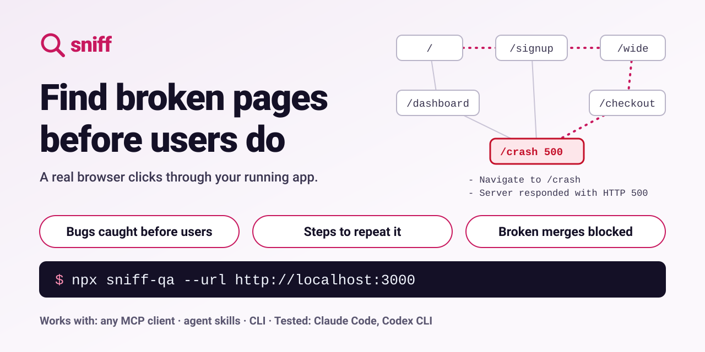
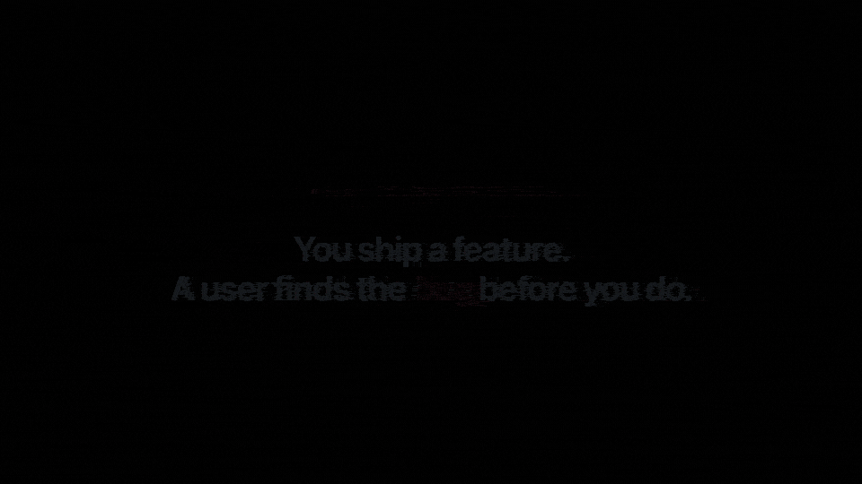

<picture>
  <source media="(prefers-color-scheme: dark)" srcset="https://raw.githubusercontent.com/Aboudjem/sniff/main/.github/assets/hero-dark.svg">
  <source media="(prefers-color-scheme: light)" srcset="https://raw.githubusercontent.com/Aboudjem/sniff/main/.github/assets/hero-light.svg">
  
</picture>

<p align="center">
  <a href="https://www.npmjs.com/package/sniff-qa"></a>
  <a href="https://github.com/Aboudjem/sniff/actions/workflows/ci.yml"></a>
  <a href="../LICENSE"></a>
</p>

<p align="center"><a href="../README.md">English</a> · <b>简体中文</b> · <a href="ja.md">日本語</a> · <a href="es.md">Español</a> · <a href="fr.md">Français</a></p>

<p align="center"><b>在用户发现之前，找出你的 Web 应用里坏掉的地方。</b></p>

<p align="center"><a href="#它做什么">它做什么</a> · <a href="#安装">安装</a> · <a href="#使用方法">使用方法</a> · <a href="#你会得到什么">你会得到什么</a> · <a href="#在你的编辑器中使用">在你的编辑器中使用</a> · <a href="#需要知道的事">需要知道的事</a></p>



```bash
claude plugin marketplace add Aboudjem/10x
claude plugin install sniff@10x
```

## 它做什么

你只改了一个表单，结果一个你从没打开过的页面开始返回 500。sniff 会用真实浏览器打开你正在运行的
应用，像用户那样逐页点过去。它报告的每个页面缺陷都附带能复现它的步骤。

### 为什么用它

- **直接修，不用找。** 每条页面结果都给出路由、步骤和修复建议，大多数还附带截图。
- **有证据表明它能抓到真缺陷。** 在故意植入的缺陷上测试：21 个中找到 21 个，干净页面上 0 条误报
  （`npm run build && npm run proof`）。
- **拦住有问题的合并。** 出现 critical 或 high 结果时 `--fail-on` 以 1 退出，`npx sniff-qa ci`
  会写好 GitHub Actions 文件。不需要 API 密钥。

它需要你的应用正在运行，而且会提交真实表单，所以请用开发或预发布环境的应用。第一次遍历会下载一次浏览器，
在 Mac 上约占 720 MB 磁盘空间。

## 安装

上面那段命令是 Claude Code 的安装方式，通过 [10x 插件市场](https://github.com/Aboudjem/10x)。对于其他
任何智能体，用 Vercel 的 skills CLI 安装同样的三个技能：

```bash
npx skills add Aboudjem/sniff
```

如果只想把它当作一个普通的命令行工具使用，不涉及任何编辑器：

```bash
npx sniff-qa --url http://localhost:3000
```

npm 包名是 `sniff-qa`，它安装出来的可执行文件名是 `sniff`。不要运行 `npx sniff`，那是一个无关的包。

<details>
<summary>Node 版本、项目内安装与 CI</summary>

需要 Node.js 22 或更高版本。`npm install -D sniff-qa` 会把它加入项目的 devDependencies，而
`npx sniff-qa ci` 会生成一个带浏览器缓存和报告产物的 GitHub Actions 工作流。
</details>

## 使用方法

**1. 启动你的应用，** 用你的项目本来就在用的那个开发服务器。

```bash
npm run dev
```

**2. 走一遍，** 在第二个终端里执行。sniff 会自动探测常用端口上的开发服务器，所以 `--url` 是可选的，
但显式传入可以免去猜测。

```bash
npx sniff-qa --url http://localhost:3000
```

**3. 阅读结果。** 结果按严重程度分组打印。下面是针对本仓库自带的植入缺陷样例应用的一次真实运行的节选，
命令为 `npx sniff-qa --url http://localhost:4321 --ci --max-pages 12`：

```text
sniff v0.8.0  walking http://localhost:4321

  26 findings (+1 low-confidence hidden; use --all)

  CRITICAL (1)
    • [confirmed] Page returns HTTP 500
      /crash  (route/broken-page)
        - Navigate to /crash
        - Server responded with HTTP 500
      fix: The route throws server-side. Check the server logs/handler for this path and return a valid page or a proper error page.
      shot: sniff-reports/crawl/_crash-desktop.png

✓ Scan complete: 26 issue(s) found. Exit code 1 so CI fails on bugs; pass --fail-on none to always exit 0.
```

加上 `--report` 可以得到一个可以直接发给别人的、自包含的 HTML 页面。如果环境看起来不对，运行
`npx sniff-qa doctor`。



## 你会得到什么

<picture>
  <source media="(prefers-color-scheme: dark)" srcset="https://raw.githubusercontent.com/Aboudjem/sniff/main/.github/assets/features-dark.svg">
  <source media="(prefers-color-scheme: light)" srcset="https://raw.githubusercontent.com/Aboudjem/sniff/main/.github/assets/features-light.svg">
  
</picture>

- **一份终端报告**，按严重程度分组，每条结果都带步骤、修复建议，大多数还带一个截图路径。
- **一个可分享的文件**，用 `--report` 得到自包含的 HTML 报告，或用 `--json` 得到 JSON。
- **一个退出码**，当结果达到 `--fail-on` 指定的严重程度时返回非零值，于是 CI 会因真实缺陷而失败。
- **每条结果上的置信度标签**。除非你传入 `--all`，否则 `uncertain` 不会显示在终端里。

0.8.0 的新增内容：

- `--caps scan,report` 把 MCP 服务器收窄到源码扫描和已保存结果的读取，不启动浏览器，也不下载浏览器。
- `--storage-state auth.json` 可以走一遍已登录的应用。该文件里的 cookie 和令牌值会从每一份写出报告的
  文本中被脱敏，但截图像素不在此列。
- `sniff.config` 里的 `assert` 块可以按严重程度给结果数量设上限（`maxCritical`、`maxHigh`、
  `maxTotal`），在命令行上由遍历、源码扫描和场景发现共同执行。

## 在你的编辑器中使用

可以在 Claude Code、Cursor、Codex、Copilot、Gemini CLI，以及另外 70 多个智能体中使用，通过
`npx skills add`。这些技能就是 Markdown 文件，所以它们运行在你的编辑器所指向的任何模型上。

| 智能体 | 一行安装命令 |
|:--|:--|
| Claude Code | `claude plugin install sniff@10x` |
| 70 多个智能体中的任意一个 | `npx skills add Aboudjem/sniff` |
| Codex、Gemini CLI、OpenCode、Pi | `./install.sh codex` |
| VS Code (Copilot) | `./install.sh copilot` |
| 其他所有 | 见 [docs/editors.md](../docs/editors.md) |

<details>
<summary>改为以 MCP 服务器方式添加</summary>

```bash
claude mcp add sniff-qa npx -- -y sniff-qa --mcp
codex mcp add sniff-qa -- npx -y sniff-qa --mcp
```

Cursor、VS Code、Gemini CLI、Windsurf、Continue、OpenCode 和 Zed 接受同一条命令，形式为 JSON 或 TOML
条目。每个编辑器的具体片段都在 [docs/editors.md](../docs/editors.md) 里。
</details>

## 需要知道的事

> [!IMPORTANT]
> 不需要 API key，不需要账号，不需要注册；除非你自己配置，否则也不会用到任何 AI 提供方。
> 遍历和扫描都不会改动你的源码。`sniff fix` 是唯一会改写代码的命令，而且只在你主动运行时才会执行。

> [!NOTE]
> 一次遍历会点击按钮并提交真实表单，因此可能产生真实数据。请把它指向开发或预发布环境，而不是生产环境。
> 第一次遍历还会下载一份 Chromium 构建并缓存下来，所以那一次运行需要网络访问。

- **它需要一个正在运行的应用。** 如果没有开发服务器在跑，它会退回到仅源码扫描，并告诉你如何开始真正的
  遍历。`npx sniff-qa scan` 可以专门运行这个扫描。
- **失效链接检查会跟进外部链接，** 所以一次遍历会向你自己的页面已经链接到的第三方 URL 发出请求。
- **发现缺陷的遍历会以 1 退出**，这是有意为之，好让 CI 判定构建失败。这不是崩溃。`--fail-on none`
  会关掉严重程度这道闸门，但 `assert` 上限仍然可能让这次运行失败。

## 了解更多

- [docs/editors.md](../docs/editors.md)，每个受支持智能体的安装方式和 MCP 片段
- [docs/authenticated-walks.md](../docs/authenticated-walks.md)，用 `--storage-state` 遍历已登录的应用
- [docs/assert-budgets.md](../docs/assert-budgets.md)，在 `sniff.config` 里按严重程度给结果设上限
- [docs/comparison.md](../docs/comparison.md)，sniff 与静态检查工具、链接检查器和 E2E 框架的区别
- [docs/faq.md](../docs/faq.md)，本页没有回答的问题
- [CHANGELOG.md](../CHANGELOG.md) · [CONTRIBUTING.md](../CONTRIBUTING.md) · [LICENSE](../LICENSE)

---

<p align="center"><sub>Built by <a href="https://github.com/Aboudjem">Adam Boudjemaa</a> · <a href="../LICENSE">Apache 2.0</a> · standing on <a href="https://playwright.dev">Playwright</a> and <a href="https://github.com/dequelabs/axe-core">axe-core</a></sub></p>

<p align="center"><sub>本文档由机器辅助翻译，英文版 <a href="../README.md">README.md</a> 为准。</sub></p>
